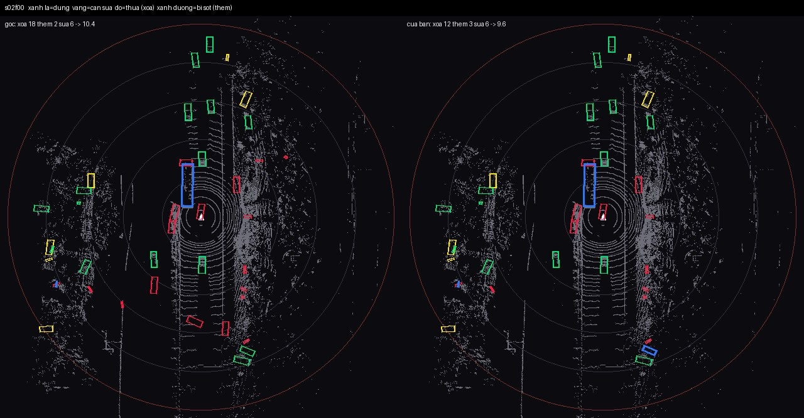

# Báo cáo Day 14 — Phạm Đức Thọ — 2A202603182

- Mã học viên dùng với `--student`: `182`
- `seed_tag` trong `frames_A.txt`: `393590736f`

## 1. Dự đoán trước sweep (bước 5b)

Ghi **trước** khi chạy `scripts/pp_sweep.py`, rồi commit và push ngay (lịch sử commit là bằng chứng thời điểm viết). Không sửa phần này sau khi có kết quả.

- Tham số tôi nghĩ giảm công sửa nhiều nhất: score_thr vì các score_thr thấp hơn 0.3 thì gần như là thừa box đánh không có vật, còn hơn lớn hơn 0,4 và nhỏ hơn 0,5 thì vẫn đúng box hoặc sai
- Vì sao (nhìn ảnh BEV tập A: box thừa nhiều hay box sót nhiều?): Box thừa nhiều hơn sót, nhiều box đánh thừa không đúng , box sót hầu như chỉ 1 đến 2 box ở mỗi ảnh

## 2. Tập A: sửa tay và tune

| Cấu hình | Xóa | Thêm | Sửa | Chi phí |
|---|---:|---:|---:|---:|
| Gốc (`score_thr=0.1, min_points=0`) | 35 | 7 | 7 | 21.0 |
| `best_config.json` (`score_thr=0.2, min_points=5`) | 29 | 8 | 7 | 20.2 |

- Tham số đã đổi trong `best_config.json`: `score_thr: 0.1 -> 0.2`; `min_points: 0 -> 5`.
- Kết quả leave-one-out (`scripts/pp_sweep.py`):
  - `s02f00`: cấu hình chọn `{'score_thr': '0.3', 'min_points': '0'}` → `15.3` (tốt nhất có thể `9.6`)
  - `s03f12`: cấu hình chọn `{'score_thr': '0.2', 'min_points': '5'}` → `6.2` (tốt nhất có thể `5.6`)
  - `s05f15`: cấu hình chọn `{'score_thr': '0.2', 'min_points': '5'}` → `4.4` (tốt nhất có thể `4.4`)
- Cấu hình có ổn định trên từng frame không? Vì sao tôi vẫn chọn (hoặc không chọn) nó:
  - Tương đối ổn định (2/3 frame), nhưng chưa hoàn toàn: ở leave-one-out, khi bỏ `s03f12` và `s05f15` thì cả hai đều chọn đúng `score_thr=0.2, min_points=5` và cho chi phí rất sát mức tốt nhất (`6.2` vs `5.6`; `4.4` vs `4.4`).
  - Tôi vẫn chọn vì đây là mức lọc nhẹ và an toàn: trên cả 3 frame Tập A đều không làm tệ đi frame nào (`s02f00` giảm `10.4 → 9.6`, hai frame kia giữ nguyên `6.2` và `4.4`), lọc bớt được 6 hộp thừa mà chỉ tăng 1 hộp sót, tránh được rủi ro sót nhiều vật thật như khi đẩy `score_thr ≥ 0.3`.

## 3. Trước/sau (bước 8)

- `scripts/pp_compare.py` báo giảm **4%** công sửa trên tập A (`21.0 -> 20.2`; `s02f00: 10.4 -> 9.6`, `s03f12: 6.2 -> 6.2`, `s05f15: 4.4 -> 4.4`).
- Dự đoán ở mục 1 đúng hay sai? Giải thích bằng số box xóa/thêm/sửa: Mục 1 dự đoán đúng hướng về tham số (`score_thr` kết hợp `min_points` giúp lọc hộp thừa), nhưng ngưỡng thực tế tối ưu chỉ là `score_thr=0.2` (thấp hơn mức `0.3–0.4` đã đoán) vì khi lọc mạnh hơn số hộp bị sót tăng nhanh. Cụ thể từ gốc sang `best_config.json`, số hộp phải xóa giảm từ `35` xuống `29` (−6), số hộp phải sửa giữ nguyên `7`, còn số hộp phải thêm tăng nhẹ từ `7` lên `8` (+1), nhờ đó tổng chi phí giảm từ `21.0` xuống `20.2`. Vẫn có trường hợp hy hữu hộp có score trong khoảng `0.5–0.6` nhưng vẫn đặt sai nên vẫn cần kiểm tra và xóa/sửa thủ công.

## 4. Tập B

Số đo từ `scripts/pp_prelabel.py --frames d14_182/frames_B.txt --config d14_182/best_config.json --gt d14_182/ref_B.json` (12 frame: GT 292, dự đoán 368, khớp 275):

| Xóa | Thêm | Sửa | Chi phí |
|---:|---:|---:|---:|
| 93 | 17 | 19 | 54.4 |

- Loại box tốn công sửa nhất ở tập B: box `Car` vì có nhiều box thừa, một số box lệch hướng `yaw` và vẫn có vài trường hợp bị sót cần vẽ thêm.

## 5. Giới hạn

- **Tập tune quá nhỏ (chỉ 3 frame):** Kết quả sweep rất nhạy với từng frame lẻ (thấy rõ ở leave-one-out khi bỏ `s02f00`, cấu hình chọn bị nhảy sang `score_thr=0.3` làm chi phí vọt lên `15.3`), nên tham số tốt nhất trên 3 frame chưa chắc tối ưu cho Tập B hay dữ liệu mới.
- **Chênh lệch miền dữ liệu (domain gap) giữa KITTI và VF:** Model PointPillars train trên KITTI (LiDAR 64 tia, chỉ góc nhìn phía trước, 3 class `Car`/`Pedestrian`/`Cyclist`), còn dữ liệu VF dùng LiDAR 40 tia, 360° và 5 class (thêm `Truck`, `Bus`). Vì vậy model hay bỏ sót `Pedestrian`/`Cyclist` thưa điểm, sinh nhiều hộp thừa và không tự nhận diện được `Truck`/`Bus`.